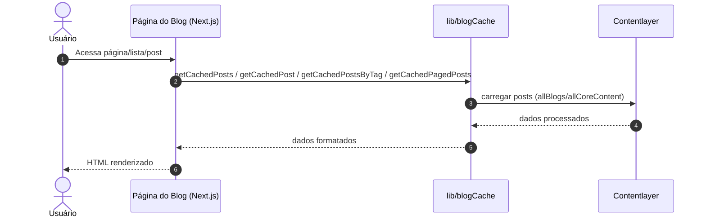

# nataliagranato.github.io

[](https://vercel.com/new/git/external?repository-url=https://github.com/timlrx/tailwind-nextjs-starter-blog)

Este é um template inicial de blog usando [Next.js](https://nextjs.org/) e [Tailwind CSS](https://tailwindcss.com/). A versão 2 é baseada no diretório App do Next.js com [Componentes de Servidor do React](https://nextjs.org/docs/getting-started/react-essentials#server-components) e utiliza o [Contentlayer](https://www.contentlayer.dev/) para gerenciar conteúdo em markdown.

Site pessoal e blog de Natália Granato, focado em tecnologias Cloud Native, containers, Infraestrutura como Código, Observabilidade, DevSecOps e temas relacionados à CNCF.

---

## Sobre o Projeto

Este projeto utiliza [Next.js](https://nextjs.org/), [Tailwind CSS](https://tailwindcss.com/), [Contentlayer](https://www.contentlayer.dev/) e integra monitoramento completo com Sentry, proporcionando uma experiência otimizada e observabilidade em produção.

**Principais tecnologias:**

- **Performance**: Contentlayer para processamento eficiente de conteúdo MDX
- **Observabilidade**: Sentry para monitoramento de erros, logging e feedback de usuários
- **Infraestrutura**: Deploy otimizado para Vercel com source maps e configurações de produção

Principais temas abordados:

- Cloud Native, Kubernetes, Docker, Observabilidade, DevOps, DevSecOps, automações, ferramentas CNCF.

---

## Instalação e Uso Local

**Pré-requisitos:**

- Node.js 22.x ou superior
- npm

**Clone o repositório:**

```bash
git clone https://github.com/nataliagranato/nataliagranato.github.io.git
cd nataliagranato.github.io
```

**Instale as dependências:**

```bash
npm install
```

**Configuração de ambiente:**

- Copie o arquivo `.env.example` para `.env` e configure as variáveis de ambiente conforme necessário:
  - **Sentry**: DSN, organização e projeto para monitoramento de erros
- Para testar o Sentry, configure o DSN e habilite a página de teste com `NEXT_PUBLIC_ENABLE_SENTRY_TEST_PAGE=true`.

**Inicie o servidor de desenvolvimento:**

```bash
npm run dev
```

Abra [http://localhost:3000](http://localhost:3000) no navegador.

---

## Principais Funcionalidades

### Monitoramento e Observabilidade com Sentry

- **Monitoramento de Erros**: Captura automática de erros JavaScript/TypeScript no frontend e backend
- **Logging Avançado**: Integração com console.log, console.warn, console.error para envio automático ao Sentry
- **Performance Monitoring**: Rastreamento de performance com sampling configurável por ambiente
- **User Feedback**: Widget integrado para coleta de feedback dos usuários
- **Source Maps**: Upload automático de source maps para debugging em produção
- **Configuração Multi-Runtime**: Suporte para Server, Client e Edge runtimes do Next.js
- **Controle por Ambiente**: Configuração flexível via variáveis de ambiente para desenvolvimento/produção

#### Variáveis de Ambiente do Sentry

```bash
# Configuração básica
SENTRY_DSN=seu_dsn_aqui
NEXT_PUBLIC_SENTRY_ORG=sua_organizacao
NEXT_PUBLIC_SENTRY_PROJECT=seu_projeto

# Controles de produção
SENTRY_TRACES_SAMPLE_RATE=0.05          # Taxa de sampling (5% em prod)
SENTRY_ENABLE_LOGS=true                  # Habilitar logs (padrão: true)
NEXT_PUBLIC_ENABLE_SENTRY_TEST_PAGE=false # Página de teste (padrão: false)

# Upload de source maps
SENTRY_ORG=sua_organizacao
SENTRY_PROJECT=seu_projeto
SENTRY_AUTH_TOKEN=seu_token_de_auth
```

#### Página de Teste do Sentry

- Acessível em `/test-sentry` (apenas quando `NEXT_PUBLIC_ENABLE_SENTRY_TEST_PAGE=true`)
- Interface para testar: geração de erros, logs console, Sentry.logger e feedback de usuário
- Protegida em produção (retorna 404 por padrão)
- Metadata com `robots: noindex` para evitar indexação

---

## Diagramas de Arquitetura

### Renderização de Posts do Blog



---

## Customização

- Editar o layout em `app/` ou o conteúdo em `data/`.
- Posts e artigos em `data/blog/`.
- Informações de autor em `data/authors/default.mdx`.
- Configurações de projetos em `data/projectsData.ts`.
- Links de navegação em `data/headerNavLinks.ts`.
- Favicons/imagens em `public/static/`.
- Configuração do cache e API em `.env`.

---

## Documentação

- **docs/SENTRY_CONFIG.md**: Configuração completa do Sentry, monitoramento de erros, logging e feedback de usuários.
- **docs/MONITORING.md**: Documentação sobre monitoramento e observabilidade.

---

## Newsletter

A newsletter é própria do site: não usa Mailchimp, Buttondown, Resend nem Substack. O formulário em português fica na página inicial e no final de cada post. A inscrição só vale depois do clique no e-mail de confirmação (double opt-in). Todo e-mail leva um link de cancelamento em um clique e os cabeçalhos `List-Unsubscribe` e `List-Unsubscribe-Post`.

Os assinantes ficam num **Vercel Blob privado**. É o armazenamento nativo da Vercel e só adiciona a dependência `@vercel/blob`. Um banco Postgres ou Redis do Marketplace serviria, mas a lista é um conjunto pequeno de documentos JSON; Blob evita provisionar outro serviço, outra conta e mais variáveis. Cada assinante e cada post já enviado são um objeto separado, então duas inscrições ao mesmo tempo não se apagam. Em desenvolvimento, sem token de Blob, os mesmos arquivos vão para `.data/newsletter` (ou `NEWSLETTER_DATA_DIR`).

O envio usa SMTP com Nodemailer (`SMTP_HOST`, `SMTP_PORT`, `SMTP_USER`, `SMTP_PASS`, `MAIL_FROM`), inclusive com senha de app do Gmail.

### Variáveis de ambiente

Defina na Vercel em **Project → Settings → Environment Variables**, no ambiente Production. Para testar na máquina, copie `.env.example` para `.env.local`.

| Variável                                   | Obrigatória em produção | Função                                                                                                                 |
| ------------------------------------------ | ----------------------- | ---------------------------------------------------------------------------------------------------------------------- |
| `SMTP_HOST`                                | sim                     | Servidor SMTP. No Gmail: `smtp.gmail.com`.                                                                             |
| `SMTP_PORT`                                | sim                     | `587` (STARTTLS) ou `465` (TLS).                                                                                       |
| `SMTP_SECURE`                              | não                     | `true` na porta 465. `false` na 587. Se vazia, `true` só quando a porta é 465.                                         |
| `SMTP_USER`                                | sim                     | Usuário da caixa de e-mail.                                                                                            |
| `SMTP_PASS`                                | sim                     | Senha ou senha de app.                                                                                                 |
| `SMTP_REQUIRE_TLS`                         | não                     | `true` para exigir STARTTLS na porta 587.                                                                              |
| `MAIL_FROM`                                | sim                     | Remetente, por exemplo `Tech Preta <contato@nataliagranato.xyz>`. No Gmail, use o mesmo endereço da conta ou um alias. |
| `NEWSLETTER_SECRET`                        | sim                     | Segredo para assinar os links de confirmação e cancelamento. Mínimo de 16 caracteres. `openssl rand -base64 32`.       |
| `NEWSLETTER_PUBLISH_SECRET`                | sim                     | Protege `POST /api/newsletter/publish`. O GitHub Actions envia este valor.                                             |
| `CRON_SECRET`                              | sim                     | A Vercel envia `Authorization: Bearer <CRON_SECRET>` no cron. Pode ser outro valor, também aceito pela rota.           |
| `BLOB_READ_WRITE_TOKEN` ou `BLOB_STORE_ID` | sim                     | Criados ao conectar o Blob store. Não inventar o valor à mão.                                                          |
| `NEWSLETTER_STORE`                         | não                     | `file` força disco local. Não use em produção.                                                                         |
| `NEWSLETTER_DATA_DIR`                      | não                     | Pasta do modo arquivo. Padrão: `.data/newsletter`.                                                                     |
| `SITE_URL`                                 | não                     | Só para testes. O endereço canônico do site é `https://nataliagranato.xyz`.                                            |

### Passos na Vercel

1. No projeto, abra **Storage → Create → Blob**. Crie um store **privado** e conecte a este projeto. O token (`BLOB_READ_WRITE_TOKEN`) ou o `BLOB_STORE_ID` com OIDC entra nas variáveis sozinho.
2. Preencha as variáveis SMTP e os dois segredos da tabela acima no ambiente **Production** e faça um novo deploy.
3. No Gmail: conta Google → Segurança → verificação em duas etapas → Senhas de app. Use essa senha em `SMTP_PASS` e o e-mail da conta em `SMTP_USER`.
4. Confirme o domínio apex `nataliagranato.xyz` como domínio de produção. Se `www.nataliagranato.xyz` também estiver no projeto, o `vercel.json` e o `next.config.js` redirecionam www para o apex. O canônico das páginas é sempre `https://nataliagranato.xyz`.
5. No GitHub, em **Settings → Secrets and variables → Actions**, crie `NEWSLETTER_PUBLISH_SECRET` com o mesmo valor da Vercel. O workflow `.github/workflows/newsletter.yml` só recebe `deployment_status` depois que este arquivo está na branch `main`.
6. A primeira chamada bem-sucedida de `/api/newsletter/publish` **não envia** os posts que já existem: ela só os marca como já tratados. Posts publicados em deploys seguintes, que não sejam rascunho, disparam um e-mail por assinante confirmado. Rodar de novo não reenvia o mesmo post.
7. O disparo principal é o GitHub Actions, quando o deploy de **Production** termina com sucesso. O cron `15 13 * * *` (todo dia, 13:15 UTC) chama a mesma rota e cobre o caso de o evento do GitHub não chegar. Dá para chamar à mão:

```bash
curl -X POST https://nataliagranato.xyz/api/newsletter/publish \
  -H "Authorization: Bearer $NEWSLETTER_PUBLISH_SECRET"
```

O cron da Vercel usa `GET` com `CRON_SECRET`. A rota aceita os dois.

Teste local, com um servidor SMTP de captura e armazenamento em disco:

```bash
npm run newsletter:test
npm run build && node scripts/newsletter-http-e2e.mjs
```

O segundo comando sobe o site já compilado e percorre o formulário, a confirmação, o cancelamento em um clique, o baseline e as rotas de SEO. O cron da Vercel não segue redirect: o domínio de produção precisa ser o apex, senão a chamada diária para em www e não chega na rota.

### HTTP 429 no site publicado

`robots.txt` e o restante do site podem responder `429` com `x-vercel-mitigated: challenge` mesmo para clientes normais. Isso vem do **Firewall / Attack Mode** no painel da Vercel, não do `vercel.json` nem do código. Em **Project → Firewall**, desligue o Attack Mode ou libere os crawlers e os caminhos `/robots.txt`, `/sitemap.xml`, `/feed.xml`, `/llms.txt` e `/llms-full.txt`. Sem isso, buscadores e agentes de IA não leem o site.

## Deploy

Este projeto está pronto para deploy no [Vercel](https://vercel.com) e pode ser facilmente integrado a ambientes cloud-native.
