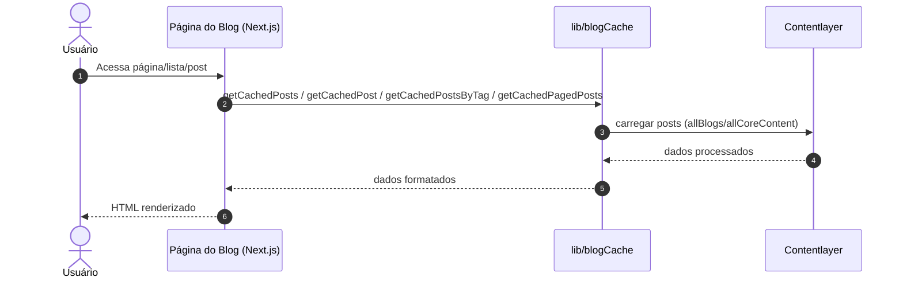

# nataliagranato.github.io

[](https://vercel.com/new/git/external?repository-url=https://github.com/timlrx/tailwind-nextjs-starter-blog)

Este é um template inicial de blog usando [Next.js](https://nextjs.org/) e [Tailwind CSS](https://tailwindcss.com/). A versão 2 é baseada no diretório App do Next.js com [Componentes de Servidor do React](https://nextjs.org/docs/getting-started/react-essentials#server-components) e utiliza o [Contentlayer](https://www.contentlayer.dev/) para gerenciar conteúdo em markdown.

Site pessoal e blog de Natália Granato, focado em tecnologias Cloud Native, containers, Infraestrutura como Código, Observabilidade, DevSecOps e temas relacionados à CNCF.

---

## Sobre o Projeto

Este projeto utiliza [Next.js](https://nextjs.org/), [Tailwind CSS](https://tailwindcss.com/) e [Contentlayer](https://www.contentlayer.dev/), com Vercel Analytics.

**Principais tecnologias:**

- **Performance**: Contentlayer para processamento eficiente de conteúdo MDX
- **Analytics**: Vercel Analytics
- **Infraestrutura**: Deploy otimizado para Vercel

Principais temas abordados:

- Cloud Native, Kubernetes, Docker, Observabilidade, DevOps, DevSecOps, automações, ferramentas CNCF.

---

## Instalação e Uso Local

**Pré-requisitos:**

- Node.js 22.x ou superior
- npm

**Clone o repositório:**

```bash
git clone https://github.com/nataliagranato/nataliagranato.github.io.git
cd nataliagranato.github.io
```

**Instale as dependências:**

```bash
npm install
```

**Configuração de ambiente:**

- Copie o arquivo `.env.example` para `.env.local` e configure as variáveis de ambiente conforme necessário (newsletter, Redis e comentários).

**Inicie o servidor de desenvolvimento:**

```bash
npm run dev
```

Abra [http://localhost:3000](http://localhost:3000) no navegador.

---

## Diagramas de Arquitetura

### Renderização de Posts do Blog



---

## Customização

- Editar o layout em `app/` ou o conteúdo em `data/`.
- Posts e artigos em `data/blog/`.
- Informações de autor em `data/authors/default.mdx`.
- Configurações de projetos em `data/projectsData.ts`.
- Links de navegação em `data/headerNavLinks.ts`.
- Favicons/imagens em `public/static/`.
- Configuração do cache e API em `.env`.

---

## Documentação

- **docs/MONITORING.md**: Documentação sobre monitoramento e observabilidade.

---

## Newsletter

A newsletter é própria do site: não usa Mailchimp, Buttondown, Resend nem Substack. O formulário em português fica na página inicial e no final de cada post. A inscrição só vale depois do clique no e-mail de confirmação (double opt-in). Todo e-mail leva um link de cancelamento em um clique e os cabeçalhos `List-Unsubscribe` e `List-Unsubscribe-Post`.

Os assinantes, o limite de tentativas e o registro do que já foi enviado ficam no **Redis** que o projeto já tem, via `REDIS_URL` (`redis://...` do Marketplace). O cliente é o pacote `redis`, reaproveitado entre invocações da mesma instância. Todas as chaves começam com `newsletter:` para não esbarrar no resto dos dados. Cada assinante e cada post já enviado são uma chave própria; `SET NX` impede que duas execuções mandem o mesmo post.

O envio usa SMTP com Nodemailer (`SMTP_HOST`, `SMTP_PORT`, `SMTP_USER`, `SMTP_PASS`, `MAIL_FROM`), inclusive com senha de app do Gmail.

### Variáveis de ambiente

Defina na Vercel em **Project → Settings → Environment Variables** nos ambientes **Production e Preview**. Para testar na máquina, copie `.env.example` para `.env.local` e suba um Redis local.

| Variável                    | Obrigatória em Production e Preview | Função                                                                                                                 |
| --------------------------- | ----------------------------------- | ---------------------------------------------------------------------------------------------------------------------- |
| `REDIS_URL`                 | sim                                 | URL `redis://` do Redis do Marketplace. Já deve existir no projeto. Local: `redis://127.0.0.1:6379`.                   |
| `SMTP_HOST`                 | sim                                 | Servidor SMTP. No Gmail: `smtp.gmail.com`.                                                                             |
| `SMTP_PORT`                 | sim                                 | `587` (STARTTLS) ou `465` (TLS).                                                                                       |
| `SMTP_SECURE`               | não                                 | `true` na porta 465. `false` na 587. Se vazia, `true` só quando a porta é 465.                                         |
| `SMTP_USER`                 | sim                                 | Usuário da caixa de e-mail.                                                                                            |
| `SMTP_PASS`                 | sim                                 | Senha ou senha de app.                                                                                                 |
| `SMTP_REQUIRE_TLS`          | não                                 | `true` para exigir STARTTLS na porta 587.                                                                              |
| `MAIL_FROM`                 | sim                                 | Remetente, por exemplo `Tech Preta <contato@nataliagranato.xyz>`. No Gmail, use o mesmo endereço da conta ou um alias. |
| `NEWSLETTER_SECRET`         | sim                                 | Segredo para assinar os links de confirmação e cancelamento. Mínimo de 16 caracteres. `openssl rand -base64 32`.       |
| `NEWSLETTER_PUBLISH_SECRET` | sim                                 | Protege `POST /api/newsletter/publish`. O GitHub Actions envia este valor.                                             |
| `CRON_SECRET`               | sim                                 | A Vercel envia `Authorization: Bearer <CRON_SECRET>` no cron. Pode ser outro valor, também aceito pela rota.           |
| `SITE_URL`                  | não                                 | Só para testes. O endereço canônico do site é `https://nataliagranato.xyz`.                                            |

### Passos na Vercel

1. Confira que `REDIS_URL` está preenchida em **Production e Preview** (Redis do Marketplace já conectado). Não é preciso criar Blob.
2. Preencha as variáveis SMTP e os segredos da tabela acima nos dois ambientes, **Production e Preview**, e faça um novo deploy.
3. No Gmail: conta Google → Segurança → verificação em duas etapas → Senhas de app. Use essa senha em `SMTP_PASS` e o e-mail da conta em `SMTP_USER`.
4. Confirme o domínio apex `nataliagranato.xyz` como domínio de produção. Se `www.nataliagranato.xyz` também estiver no projeto, o `vercel.json` e o `next.config.js` redirecionam www para o apex. O canônico das páginas é sempre `https://nataliagranato.xyz`.
5. No GitHub, em **Settings → Secrets and variables → Actions**, crie `NEWSLETTER_PUBLISH_SECRET` com o mesmo valor da Vercel. O workflow `.github/workflows/newsletter.yml` só recebe `deployment_status` depois que este arquivo está na branch `main`.
6. A primeira chamada bem-sucedida de `/api/newsletter/publish` **não envia** os posts que já existem: ela só os marca como já tratados. Posts publicados em deploys seguintes, que não sejam rascunho, disparam um e-mail por assinante confirmado. Rodar de novo não reenvia o mesmo post.
7. O disparo principal é o GitHub Actions, quando o deploy de **Production** termina com sucesso. O cron `15 13 * * *` (todo dia, 13:15 UTC) chama a mesma rota e cobre o caso de o evento do GitHub não chegar. Dá para chamar à mão:

```bash
curl -X POST https://nataliagranato.xyz/api/newsletter/publish \
  -H "Authorization: Bearer $NEWSLETTER_PUBLISH_SECRET"
```

O cron da Vercel usa `GET` com `CRON_SECRET`. A rota aceita os dois.

Teste local, com Redis em `127.0.0.1:6379` e um servidor SMTP de captura. Os scripts só falam com esse Redis local e apagam as chaves `newsletter:*` ao terminar.

```bash
redis-server --daemonize yes --port 6379 --bind 127.0.0.1 --protected-mode yes
npm run newsletter:test
npm run build && node scripts/newsletter-http-e2e.mjs
```

O segundo comando sobe o site já compilado e percorre o formulário, a confirmação, o cancelamento em um clique, o baseline e as rotas de SEO. O cron da Vercel não segue redirect: o domínio de produção precisa ser o apex, senão a chamada diária para em www e não chega na rota.

### HTTP 429 no site publicado

`robots.txt` e o restante do site podem responder `429` com `x-vercel-mitigated: challenge` mesmo para clientes normais. Isso vem do **Firewall / Attack Mode** no painel da Vercel, não do `vercel.json` nem do código. Em **Project → Firewall**, desligue o Attack Mode ou libere os crawlers e os caminhos `/robots.txt`, `/sitemap.xml`, `/feed.xml`, `/llms.txt` e `/llms-full.txt`. Sem isso, buscadores e agentes de IA não leem o site.

## Deploy

Este projeto está pronto para deploy no [Vercel](https://vercel.com) e pode ser facilmente integrado a ambientes cloud-native.
